# AmbuSync

## Continuidad del proyecto — Nota 3

Repositorio de trabajo independiente: **[pasaldo/ambusync](https://github.com/pasaldo/ambusync)** (privado).
Se conserva el historial del [prototipo original](https://github.com/brypro/ambusync).
El diagnóstico, las pruebas iniciales y el plan de evolución están en
**[docs/ANALISIS_INICIAL.md](docs/ANALISIS_INICIAL.md)**.
La definición de alcance, reglas y tareas de preparación se encuentra en
**[docs/ETAPA_0.md](docs/ETAPA_0.md)**; contiene decisiones confirmadas y propuestas pendientes de aprobación.
La preparación reproducible del frontend, el flujo de revisión y el checklist de cierre están en
**[docs/GUIA_DESARROLLO.md](docs/GUIA_DESARROLLO.md)**.
La aplicación sigue siendo un prototipo de demostración, no un sistema clínico productivo.

> Transmite la información clínica del paciente desde la **ambulancia** al **servicio de
> urgencia** en tiempo real, para que el hospital anticipe la recepción y prepare recursos
> antes del arribo.

AmbuSync es una **web app mobile-first** que en escritorio se muestra dentro de un *marco de
teléfono* (device shell) para emular una app nativa. Incluye módulos separados por rol:

- **Paramédico (ambulancia)** — captura del paciente. Modo claro, controles grandes (uso con guantes).
- **Urgencias (hospital)** — tablero de pacientes entrantes. Modo oscuro tipo monitor, lectura de un vistazo.
- **Administración global** — gestión del directorio institucional, sin acceso a episodios ni permisos clínicos.

El MVP demuestra el flujo completo **capturar → transmitir → recibir** con datos de demo.

## Muestras del funcionamiento

Capturas de las vistas locales de ambulancia, Urgencias y administración global. Todas usan un
mock con datos sintéticos; no representan sesiones ni datos leídos de un backend real.

### 1. Ingreso a la aplicación

<p align="center">
  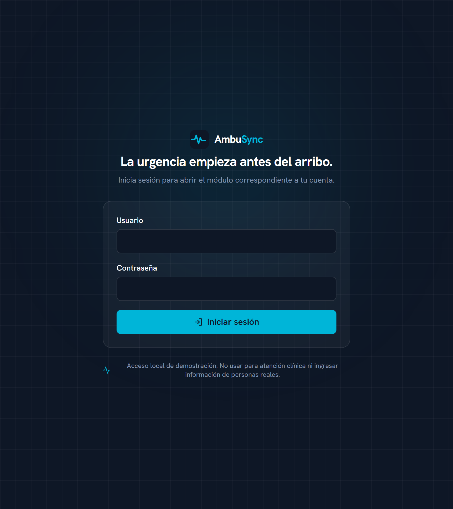
</p>

### 2. Portal local de ambulancia

La vista actual permite ingresar una emergencia desde el portal local, muestra la unidad
asignada y previsualiza los signos vitales que verá Urgencias al confirmar.

<table>
  <tr>
    <td align="center">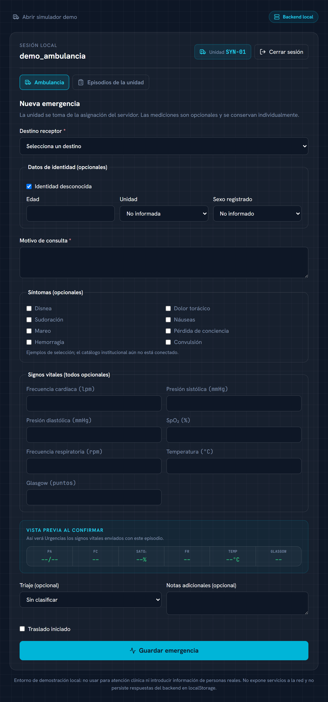<br/><sub>Inicio de la unidad</sub></td>
    <td align="center"><br/><sub>Ingreso de episodio</sub></td>
    <td align="center">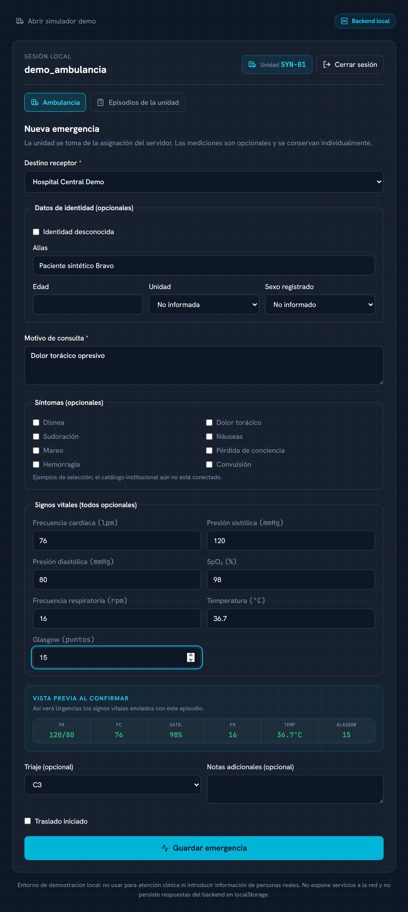<br/><sub>Vista previa de vitales</sub></td>
  </tr>
  <tr>
    <td align="center">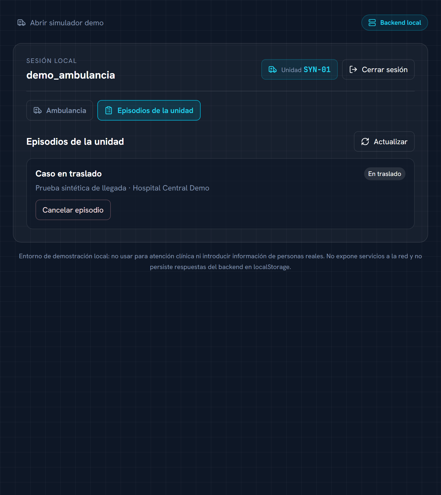<br/><sub>Episodios de la unidad</sub></td>
    <td align="center">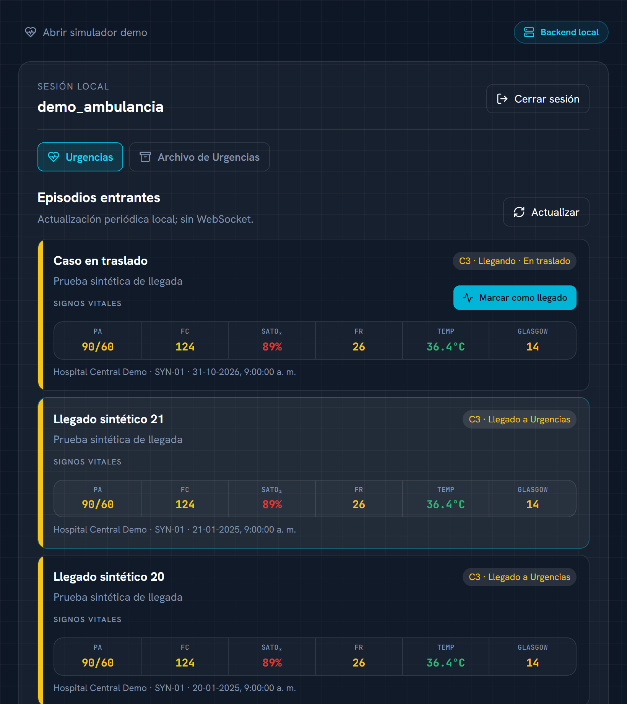<br/><sub>Urgencias entrantes</sub></td>
    <td align="center">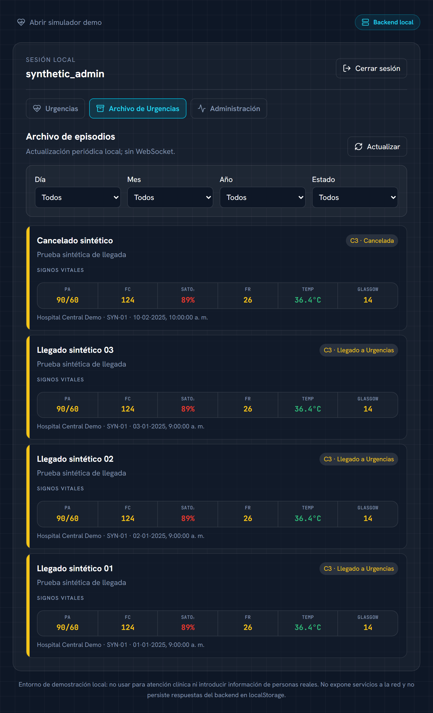<br/><sub>Archivo filtrable</sub></td>
  </tr>
</table>

### 3. Portal local de Urgencias

La bandeja actual ordena los episodios, muestra triage y signos vitales directamente,
permite registrar la llegada desde la tarjeta y conserva un archivo filtrable.

<table>
  <tr>
    <td align="center">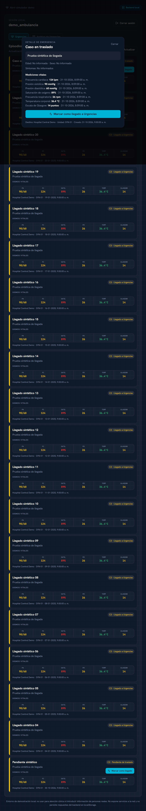<br/><sub>Detalle + signos vitales</sub></td>
    <td align="center">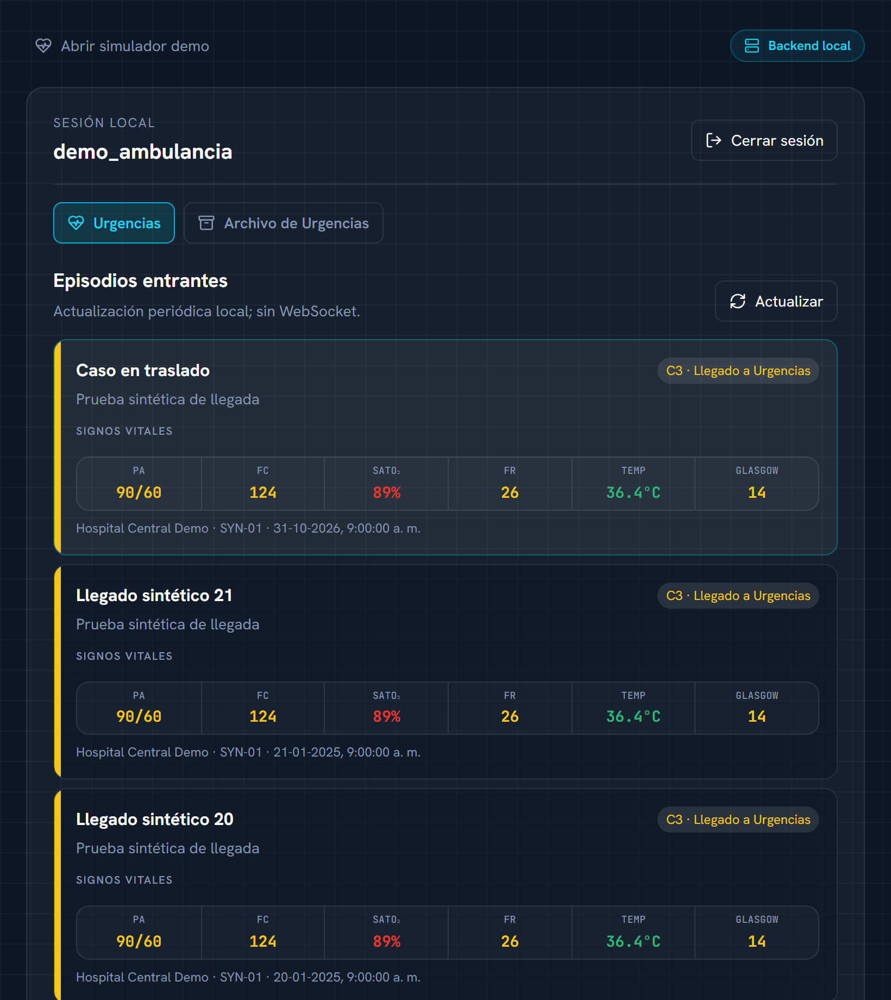<br/><sub>Llegada desde la bandeja</sub></td>
  </tr>
  <tr>
    <td align="center">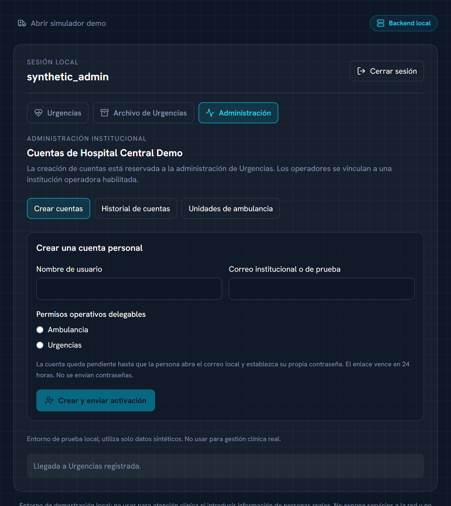<br/><sub>Administración: crear cuentas</sub></td>
    <td align="center">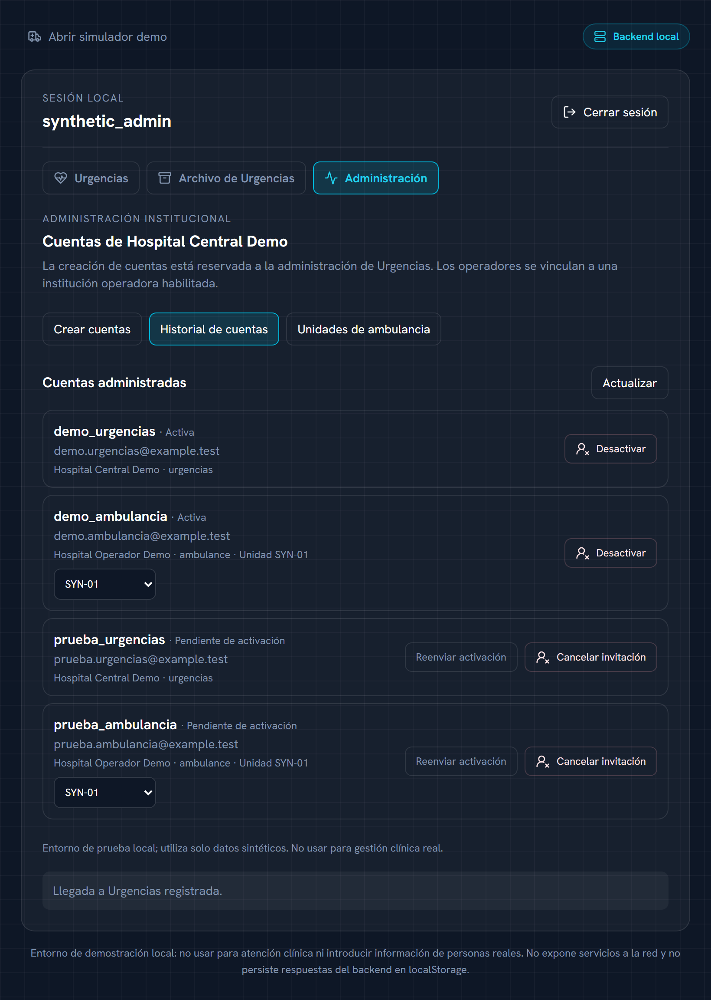<br/><sub>Historial y asignación de unidades</sub></td>
  </tr>
  <tr>
    <td align="center">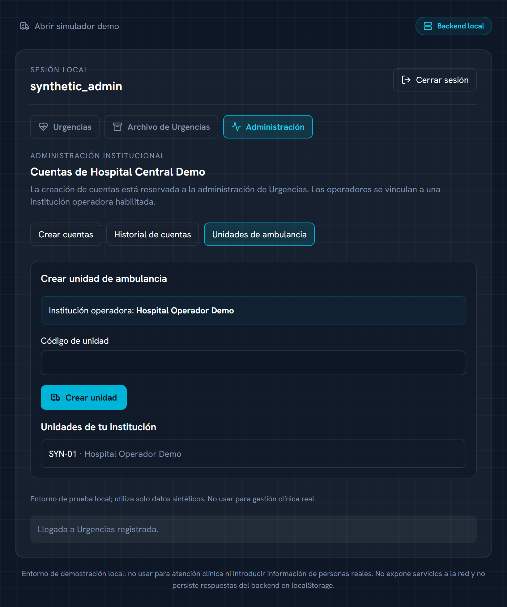<br/><sub>Unidades de ambulancia</sub></td>
  </tr>
</table>

### 4. Administración global de instituciones

El rol global exclusivo de administración lista instituciones activas e inactivas, permite editar
sus datos y conservarlas mediante baja lógica. El alta crea una institución Operadora y Receptora
que administra sus propias unidades, junto con una primera
cuenta de Urgencias con administración institucional, pendiente de activar por correo local.

<p align="center">
  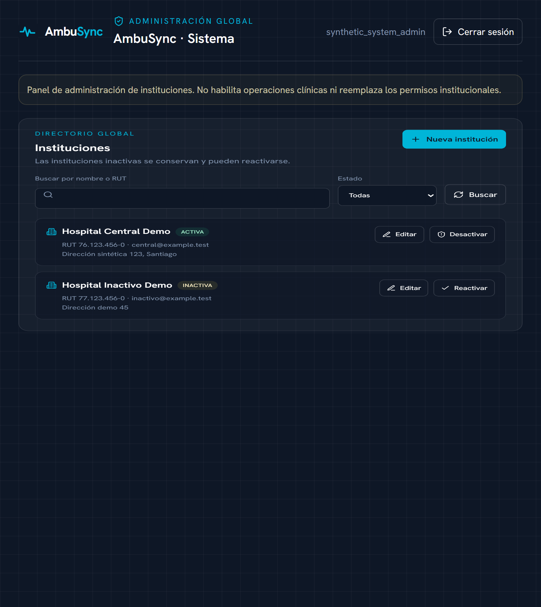
</p>

> Las capturas se regeneran con `npm run shots` y muestran vistas de `/local` y `/sistema` con el mock
> sintético (requiere Vite activo en `:5173`); no representan datos de producción ni el simulador demo.

## Stack

- **React + Vite + TypeScript**
- **TailwindCSS** (design tokens), **lucide-react** (iconos), **framer-motion** (animaciones)
- **Zustand** (estado global), **React Router** (`/ambulancia` y `/urgencias`)
- Fuentes: **Hanken Grotesk** (UI) + **JetBrains Mono** tabular (vitales/ETA)

El ingreso comienza con autenticación de cuenta en Django. Tras iniciar sesión, `/local` muestra
el módulo permitido por los grupos de esa cuenta; no se selecciona libremente una identidad.
La administración global se provisiona localmente mediante comando controlado y accede solo a `/sistema`.
Las cuentas con administración institucional pueden crear usuarios dentro de su establecimiento,
asignar permisos operativos delegables y vincular operadores a unidades existentes; la activación
requiere que cada persona defina su propia contraseña mediante correo local.
Las rutas del simulador también requieren sesión, pero sus casos de ejemplo siguen separados de
los episodios del backend.

El **tiempo real de la demo** se resuelve en el frontend: el store (Zustand) se sincroniza
**entre pestañas del mismo navegador** vía **BroadcastChannel** con respaldo en **localStorage**.
Las rutas `/ambulancia` y `/urgencias` conservan esa demo independiente. La ruta `/local` conecta
la SPA con Django + DRF para crear emergencias y consultar episodios autorizados;
usa cookie de sesión y no persiste respuestas del backend en `localStorage`. Desde el 11/11/2026,
`/local` también usa WebSocket autenticado como aviso para refrescar desde la API entre
dispositivos. Los avisos no son durables: PostgreSQL/API sigue siendo la fuente de verdad. La
integración está en `main`; no está desplegada y no autoriza uso clínico. Detalles,
dependencias y pasos de ejecución local: [docs/ETAPA_1.md](docs/ETAPA_1.md) y
[docs/GUIA_DESARROLLO.md](docs/GUIA_DESARROLLO.md).

## Estado del piloto local

La ruta `/local` integra el primer slice de Django/DRF con la SPA. Una cuenta de ambulancia ve su unidad asignada junto a la sesión y puede ingresar episodios con una previsualización de signos vitales. Urgencias dispone de una bandeja priorizada y un archivo filtrable; cada tarjeta muestra triage, signos vitales y permite confirmar la llegada sin abrir el detalle. La vista demo `/ambulancia` y `/urgencias` continúa separada de estos datos del backend.

Los colores y rangos de signos vitales son exclusivamente una ayuda visual para datos sintéticos del piloto; no constituyen reglas clínicas ni autorización de atención real.

La integración WebSocket (rama `feature/websocket-integration`, integrada en `main` el 11/11/2026 por
solicitud expresa del responsable) se verificó localmente con dos dispositivos según la comprobación
reportada; no se ha ejecutado CI remoto ni existe despliegue. La documentación y el código no
autorizan uso clínico. GPS, cambio de destino, recuperación administrativa, informes, operación
continua de copias/restauración y decisiones de hosting siguen pendientes.

## Cómo correrlo

El flujo entre dispositivos usa PostgreSQL aislado, Valkey (Redis protocol) local, Daphne/ASGI y
Vite como proxy HTTP/WebSocket. **Mailpit** solo se
necesita para probar altas/activaciones de cuentas. No se debe exponer PostgreSQL, Valkey ni Daphne
a la LAN ni a una red pública; para la prueba desde celular solo Vite escucha en la IP LAN.

Requiere **Python 3.14.10**, `uv`, **Node.js 24.20.0**, **npm 11.19.0** y el backend local
configurado según [docs/ETAPA_1.md](docs/ETAPA_1.md). Node está fijado en `.nvmrc`, Python en
`.python-version` y npm en `frontend/package.json`.

### 1. Preparar dependencias y secretos locales

Desde la raíz del repositorio, instala las dependencias del backend y frontend. El archivo
`backend/.env` debe existir con `DATABASE_URL`, `DJANGO_SECRET_KEY` y los demás valores locales;
no lo copies al repositorio ni compartas sus secretos.

```powershell
uv sync --directory backend --locked --all-groups
Set-Location frontend
npm ci
npx playwright install chromium
```

### 2. Iniciar PostgreSQL aislado

Usa el clúster de desarrollo de AmbuSync en `127.0.0.1:55432`; no uses ni modifiques el
servicio PostgreSQL preexistente en `5432`.

```powershell
$pgBin = "$env:LOCALAPPDATA\AmbuSync\postgresql-18.6-binaries\pgsql\bin"
$dataDir = "$env:LOCALAPPDATA\AmbuSync\postgres-dev-18.6"
& "$pgBin\pg_ctl.exe" -D $dataDir -o "-h 127.0.0.1 -p 55432" -l "$dataDir\server.log" start
& "$pgBin\pg_isready.exe" -h 127.0.0.1 -p 55432
```

### 3. Preparar la base y cuentas sintéticas

Ejecuta migraciones y crea las instituciones, unidad y cuentas de prueba. `seed_synthetic`
solicita las contraseñas de forma oculta y no imprime credenciales.

```powershell
uv run --directory backend python manage.py migrate
uv run --directory backend python manage.py seed_synthetic
```

### 4. Iniciar Valkey local (WSL)

La línea WebSocket requiere Valkey y `VALKEY_URL` en el `backend/.env` local. En este equipo Valkey
escucha solo por loopback. Mantén WSL activo durante la prueba; los pasos completos de instalación
y comprobación están en [ETAPA_1.md](docs/ETAPA_1.md#valkey-local-en-wsl).

```powershell
wsl -d Ubuntu -- bash -lc "sudo systemctl start valkey-server && exec sleep infinity"
```

Deja ese comando ejecutándose en una terminal. En otra, comprueba que Valkey devuelve `PONG`:

```powershell
wsl -d Ubuntu -- valkey-cli -h 127.0.0.1 -p 6379 ping
```

### 5. Iniciar Daphne/ASGI

En otra terminal desde la raíz, usa Daphne (no `manage.py runserver`) para servir HTTP y WebSocket:

```powershell
uv run --directory backend daphne -b 127.0.0.1 -p 8000 config.asgi:application
```

### 6. Iniciar el frontend

En otra terminal:

```powershell
cd frontend
npm run dev -- --host 127.0.0.1
```

Abre <http://127.0.0.1:5173> e inicia sesión con una cuenta sintética. Para probar desde otro
dispositivo, sigue los pasos LAN de [ETAPA_1.md](docs/ETAPA_1.md): Vite debe enlazarse a la IP LAN
del PC, mientras Daphne y Valkey permanecen en loopback. El login abre `/local` y muestra el módulo
permitido por los grupos de la cuenta. Las rutas `/ambulancia` y `/urgencias` son el simulador demo
separado y también requieren sesión.

### 7. Mailpit para activaciones locales

**Mailpit es obligatorio para probar la creación, activación o reenvío de cuentas desde
Administración.** Inícialo antes de realizar esas operaciones. El backend usa SMTP local en
`127.0.0.1:1025` y su interfaz web habitual está en <http://127.0.0.1:8025>, donde se consultan
los mensajes sintéticos y sus enlaces de activación. La configuración actual no envía correos
externos. Solo puede omitirse Mailpit si se ejecutan exclusivamente los flujos que no crean ni
activan cuentas.

```powershell
# Reemplaza la ruta por la carpeta real donde está instalado mailpit.exe.
$env:Path += ";C:\ruta\a\mailpit"
mailpit.exe --smtp 127.0.0.1:1025 --listen 127.0.0.1:8025
```

### 8. Detener servicios locales

Cuando termines el trabajo local:

```powershell
& "$pgBin\pg_ctl.exe" -D $dataDir -m fast stop
```

Detén Daphne y Vite con `Ctrl+C` en sus terminales. Detén la espera que mantiene WSL activo con
`Ctrl+C`; no deshabilites ni expongas Valkey. Para acceso desde celular, no uses esta instrucción
de Vite en loopback: sigue el procedimiento seguro de [ETAPA_1.md](docs/ETAPA_1.md#prueba-local-entre-dispositivos).

### Verificaciones

Desde `frontend/`:

```bash
npm run lint
npm run test:unit
npm run test:local-websocket
npm run check:diagrams
npm run test:sync       # requiere Vite activo
npm run test:accounts   # flujo local con mock sintético
npm run build
npm run shots           # actualiza capturas de /local y /sistema; requiere Vite activo
```

Desde la raíz:

```powershell
uv run --directory backend python manage.py test
uv run --directory backend python manage.py check
uv run --directory backend python manage.py makemigrations --check --dry-run
uv run --directory backend ruff check .
uv run --directory backend pip-audit
uv run --directory backend openapi-spec-validator openapi.json
```

## Cómo demostrarlo

**Demo en vivo entre dos ventanas** (lo más vistoso): abre la app en **dos ventanas lado a
lado** del mismo navegador — una en **Urgencias** (`/urgencias`) y otra en **Paramédico**
(`/ambulancia`). Captura un paciente en la ambulancia y pulsa **Transmitir al hospital**: el
caso aparece **en vivo** en el tablero de Urgencias (badge **NUEVO** + countdown corriendo),
y los cambios de estado (*Aceptar*, *Preparar box*, *Marcar recibido*) se reflejan en ambas.
Primero inicia sesión en la raíz con una cuenta local; la demo usa el navegador y el backend debe
estar activo para validar la sesión.

Otras formas de mostrarlo:

1. Entra como **Urgencias**: el tablero arranca sembrado con casos de demo (triage variado),
   con countdowns de ETA vivos. Toca una tarjeta para ver el detalle y las acciones.
2. Pulsa **Modo demo** (pie del tablero) para que entre un caso crítico guionado y veas la
   animación de "aterrizaje" + el badge **NUEVO** — ideal para grabar el video en una pantalla.

## Arquitectura

La demo frontend es una **SPA React** que vive en el navegador. El estado global
(`useCases`, Zustand) actúa como un **bus de tiempo real**: el flujo del paramédico publica un
`Case` y el tablero de Urgencias, suscrito reactivamente, lo refleja al instante. Ese bus se
sincroniza **entre pestañas** ([`sync.ts`](frontend/src/store/sync.ts)) con **BroadcastChannel**
(push) + **localStorage** (persistencia y late-join), así que dos ventanas del mismo navegador
ven los mismos casos de ejemplo en vivo. El backend local usa su propia API y PostgreSQL; la ruta
`/local` no conecta con ese store. La sincronización WebSocket entre dispositivos y la edición de
estados desde la SPA quedan pendientes.

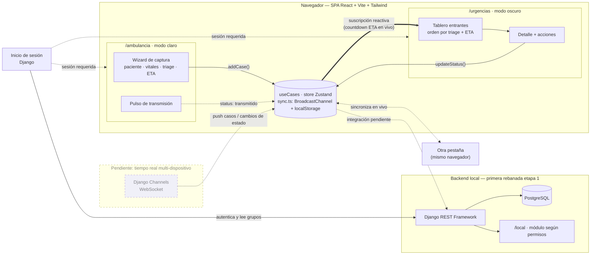

**Ciclo de vida de un `Case`** — el estado que el objeto recorre desde la captura hasta la recepción:

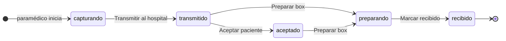

## Modelo de datos

El objeto central es **`Case`** (`CaseRecord` en [`types.ts`](frontend/src/types.ts)): el
paquete que "viaja" de la ambulancia a Urgencias. En el MVP, `Patient` y `Vitals` van
**embebidos** en el caso, y la ambulancia/hospital se guardan denormalizados (`ambulanceCode`,
`hospitalName`); el triage es un nivel `1..5` resuelto contra la tabla de triage.

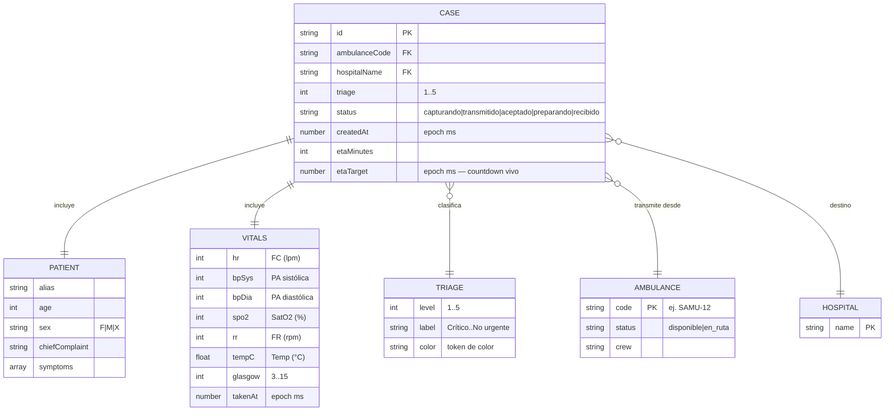

## Estructura

```
ambusync/
├── frontend/                 # Vite + React + Tailwind (el MVP)
│   ├── src/
│   │   ├── components/        # PhoneFrame, VitalsStrip, TriageBadge, EtaCountdown, ui/
│   │   ├── screens/           # LoginScreen, ambulance/, er/, local/
│   │   ├── store/             # useCases (Zustand) + sync.ts (BroadcastChannel/localStorage)
│   │   ├── data/              # triage, vitals, status, seed
│   │   └── types.ts           # modelo de datos (CaseRecord)
│   ├── scripts/               # shots.mjs (capturas), check-mermaid.mjs (valida diagramas)
│   └── tailwind.config.js     # design tokens
├── docs/screenshots/         # muestras del funcionamiento (este README)
├── CLAUDE.md                 # contexto persistente
└── README.md
```

## Calidad

Responsive desde 360 px, foco de teclado visible, `prefers-reduced-motion` respetado,
contraste AA y copy en voz activa. El color **codifica gravedad** (triage), no decora; el
acento cian representa la señal/sincronización en vivo.

## Estado del MVP

| Fase | Descripción | Estado |
|---|---|---|
| 0 | Scaffold + design tokens | ✅ |
| 1 | PhoneFrame + navegación + ingreso centralizado | ✅ |
| 2 | Flujo del paramédico (wizard + transmisión) | ✅ |
| 3 | Tablero de Urgencias + tiempo real simulado | ✅ |
| 4–5 | Backend local Django + DRF + PostgreSQL; WebSocket para avisos en tiempo real | Primera rebanada implementada; WebSocket integrado en `main` el 11/11/2026 (prueba manual PC-celular reportada satisfactoria); sin CI remoto ni despliegue |
| 6 | Pulido, modo demo y documentación | ✅ |

> Proyecto académico.
