# AmbuSync

## Continuidad del proyecto — Nota 3

Repositorio de trabajo independiente: **[pasaldo/ambusync](https://github.com/pasaldo/ambusync)** (privado).
Se conserva el historial del [prototipo original](https://github.com/brypro/ambusync).
El diagnóstico, las pruebas iniciales y el plan de evolución están en
**[docs/ANALISIS_INICIAL.md](docs/ANALISIS_INICIAL.md)**.
La aplicación sigue siendo un prototipo de demostración, no un sistema clínico productivo.

> Transmite la información clínica del paciente desde la **ambulancia** al **servicio de
> urgencia** en tiempo real, para que el hospital anticipe la recepción y prepare recursos
> antes del arribo.

AmbuSync es una **web app mobile-first** que en escritorio se muestra dentro de un *marco de
teléfono* (device shell) para emular una app nativa. Tiene dos vistas según el rol:

- **Paramédico (ambulancia)** — captura del paciente. Modo claro, controles grandes (uso con guantes).
- **Urgencias (hospital)** — tablero de pacientes entrantes. Modo oscuro tipo monitor, lectura de un vistazo.

El MVP demuestra el flujo completo **capturar → transmitir → recibir** con datos de demo.

## Muestras del funcionamiento

El flujo completo **capturar → transmitir → recibir**, capturado de la app en ejecución.

### 1. Selección de rol

<p align="center">
  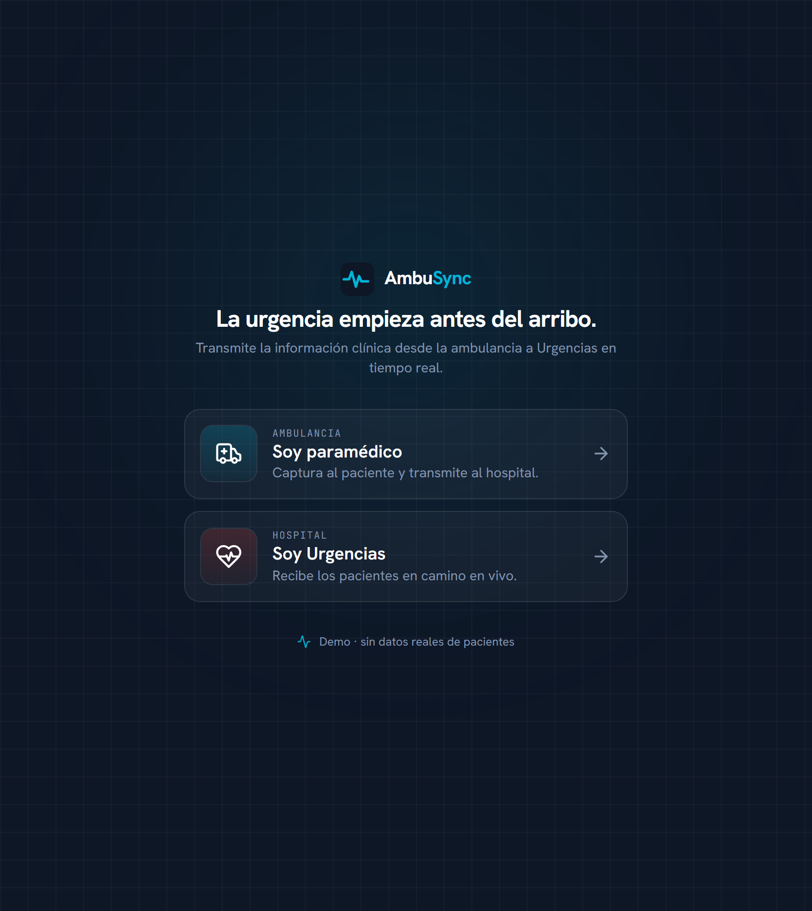
</p>

### 2. Ambulancia — captura del paciente

El paramédico abre una nueva emergencia y completa un wizard de 5 pasos. Los signos
vitales se ingresan con controles grandes y se previsualizan en la tira del monitor;
el triage viaja con el paciente.

<table>
  <tr>
    <td align="center">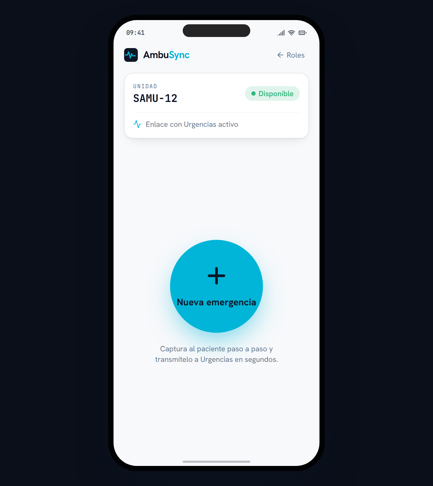<br/><sub>Inicio de la unidad</sub></td>
    <td align="center">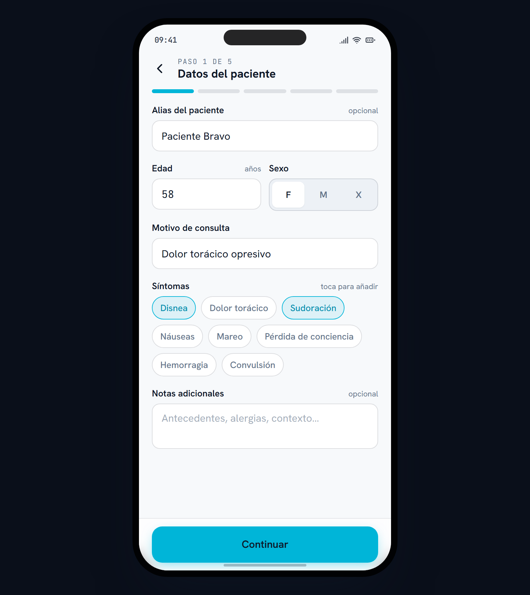<br/><sub>1 · Datos del paciente</sub></td>
    <td align="center">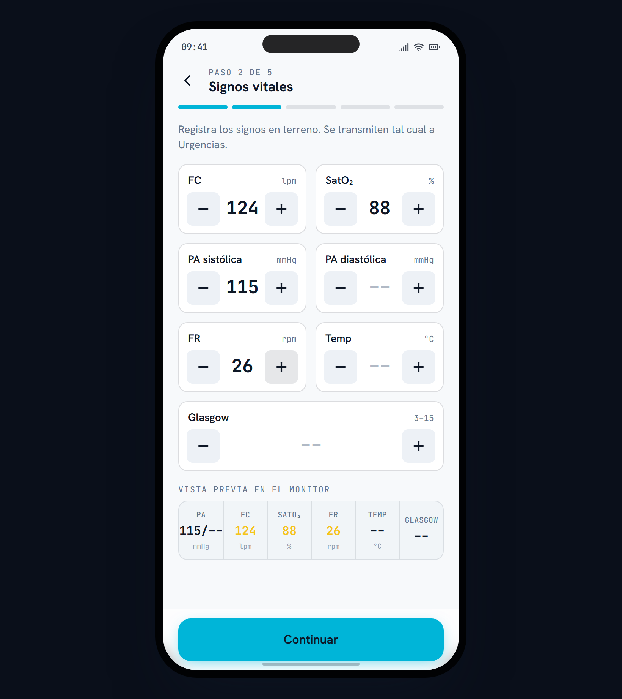<br/><sub>2 · Signos vitales</sub></td>
  </tr>
  <tr>
    <td align="center">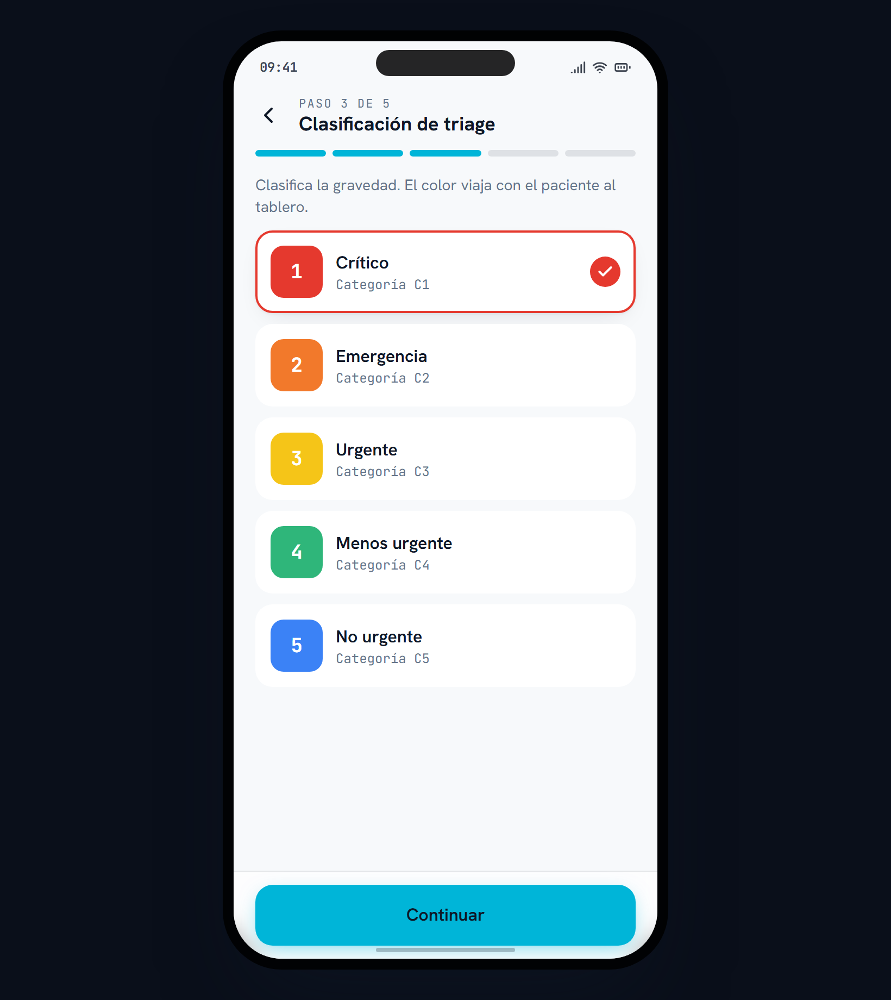<br/><sub>3 · Triage por color</sub></td>
    <td align="center">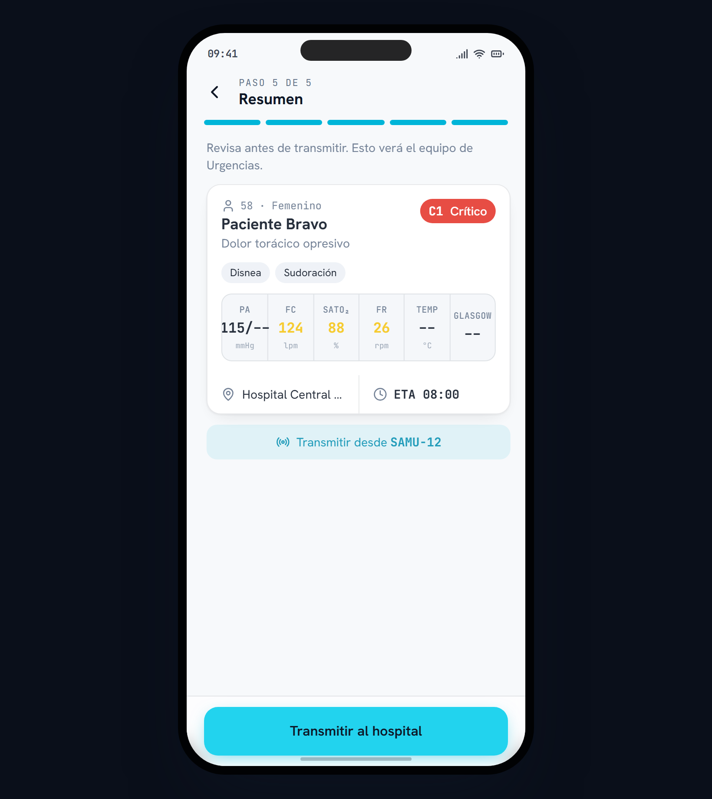<br/><sub>5 · Resumen</sub></td>
    <td align="center">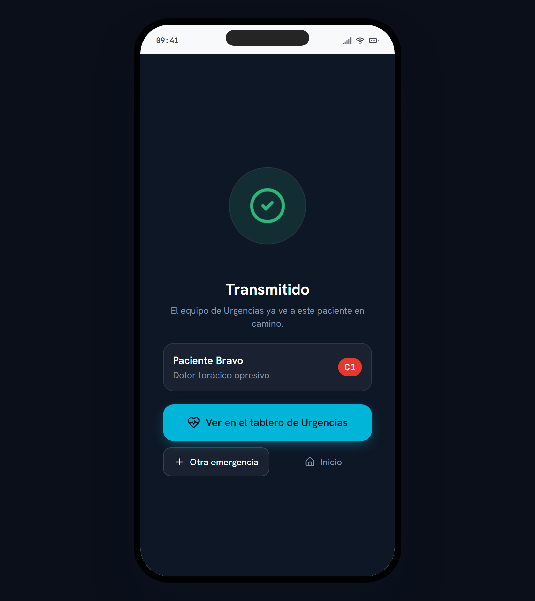<br/><sub>Transmitido ✓</sub></td>
  </tr>
</table>

### 3. Urgencias — tablero en vivo

El tablero recibe los casos ordenados por triage y ETA, con el countdown corriendo en
vivo y los signos anormales resaltados. Al tocar una tarjeta se abre el detalle con las
acciones de recepción.

<table>
  <tr>
    <td align="center">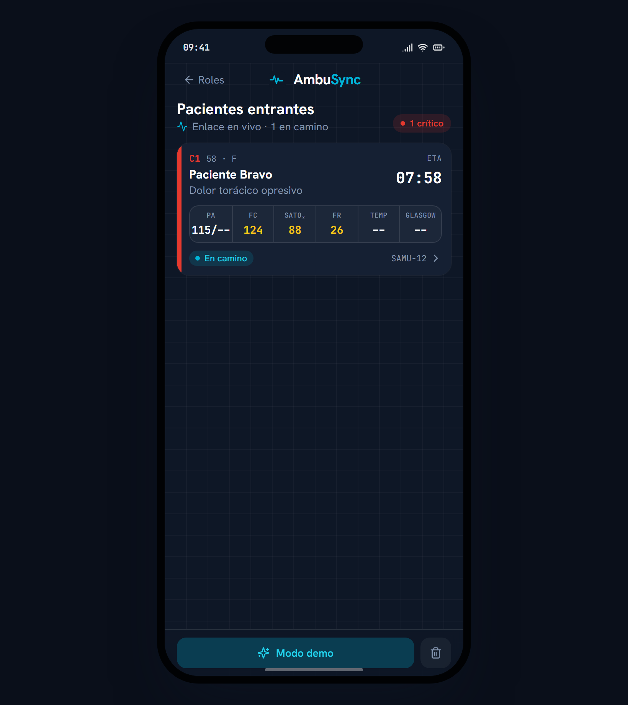<br/><sub>Tablero "Pacientes entrantes"</sub></td>
    <td align="center">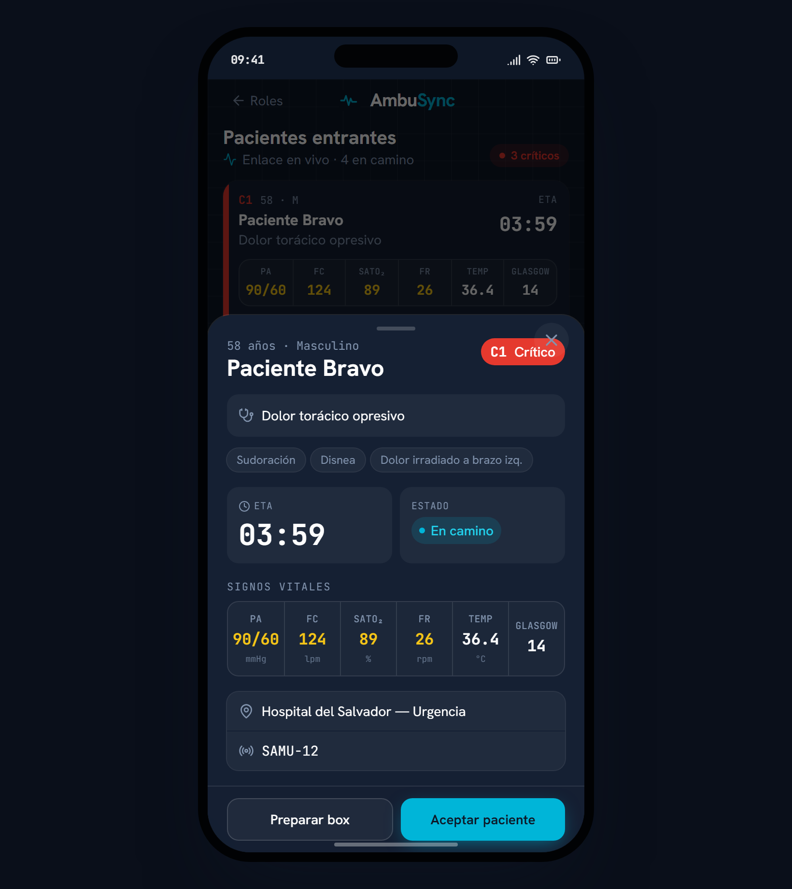<br/><sub>Detalle + acciones</sub></td>
  </tr>
</table>

> Las capturas se regeneran con `npm run shots` (requiere el dev server corriendo en `:5173`).

## Stack

- **React + Vite + TypeScript**
- **TailwindCSS** (design tokens), **lucide-react** (iconos), **framer-motion** (animaciones)
- **Zustand** (estado global), **React Router** (`/ambulancia` y `/urgencias`)
- Fuentes: **Hanken Grotesk** (UI) + **JetBrains Mono** tabular (vitales/ETA)

El **tiempo real** se resuelve en el frontend, sin backend: el store (Zustand) se sincroniza
**entre pestañas del mismo navegador** vía **BroadcastChannel** (push instantáneo) con respaldo
en **localStorage** (persiste al recargar y alimenta a las pestañas que se abren después). Así
puedes abrir `/ambulancia` y `/urgencias` en dos ventanas y ver el caso aparecer en vivo. El
backend Django + DRF + Channels (Fases 4–5) —para sincronizar entre **dispositivos** distintos—
queda como trabajo futuro.

## Cómo correrlo

Requiere **Node.js 18+**.

```bash
cd frontend
npm install
npm run dev
```

Abre <http://localhost:5173>. En escritorio verás el marco de teléfono; en móvil ocupa toda la pantalla.

Otros comandos:

```bash
npm run build     # typecheck (tsc -b) + build de producción en dist/
npm run preview   # sirve el build de producción
```

## Cómo demostrarlo

**Demo en vivo entre dos ventanas** (lo más vistoso): abre la app en **dos ventanas lado a
lado** del mismo navegador — una en **Urgencias** (`/urgencias`) y otra en **Paramédico**
(`/ambulancia`). Captura un paciente en la ambulancia y pulsa **Transmitir al hospital**: el
caso aparece **en vivo** en el tablero de Urgencias (badge **NUEVO** + countdown corriendo),
y los cambios de estado (*Aceptar*, *Preparar box*, *Marcar recibido*) se reflejan en ambas.

Otras formas de mostrarlo:

1. Entra como **Urgencias**: el tablero arranca sembrado con casos de demo (triage variado),
   con countdowns de ETA vivos. Toca una tarjeta para ver el detalle y las acciones.
2. Pulsa **Modo demo** (pie del tablero) para que entre un caso crítico guionado y veas la
   animación de "aterrizaje" + el badge **NUEVO** — ideal para grabar el video en una pantalla.

## Arquitectura

El MVP es una **SPA React** que vive completa en el navegador. El estado global
(`useCases`, Zustand) actúa como un **bus de tiempo real**: el flujo del paramédico publica un
`Case` y el tablero de Urgencias, suscrito reactivamente, lo refleja al instante. Ese bus se
sincroniza **entre pestañas** ([`sync.ts`](frontend/src/store/sync.ts)) con **BroadcastChannel**
(push) + **localStorage** (persistencia y late-join), así que dos ventanas del mismo navegador
ven los mismos datos en vivo. El backend Django + WebSockets (Fases 4–5) —que llevaría esa
sincronización entre dispositivos distintos— queda como trabajo futuro; su punto de integración
es justamente ese store.

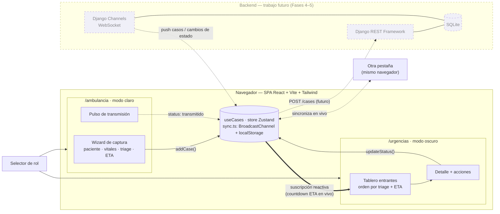

**Ciclo de vida de un `Case`** — el estado que el objeto recorre desde la captura hasta la recepción:

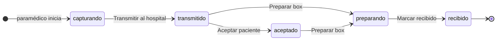

## Modelo de datos

El objeto central es **`Case`** (`CaseRecord` en [`types.ts`](frontend/src/types.ts)): el
paquete que "viaja" de la ambulancia a Urgencias. En el MVP, `Patient` y `Vitals` van
**embebidos** en el caso, y la ambulancia/hospital se guardan denormalizados (`ambulanceCode`,
`hospitalName`); el triage es un nivel `1..5` resuelto contra la tabla de triage.

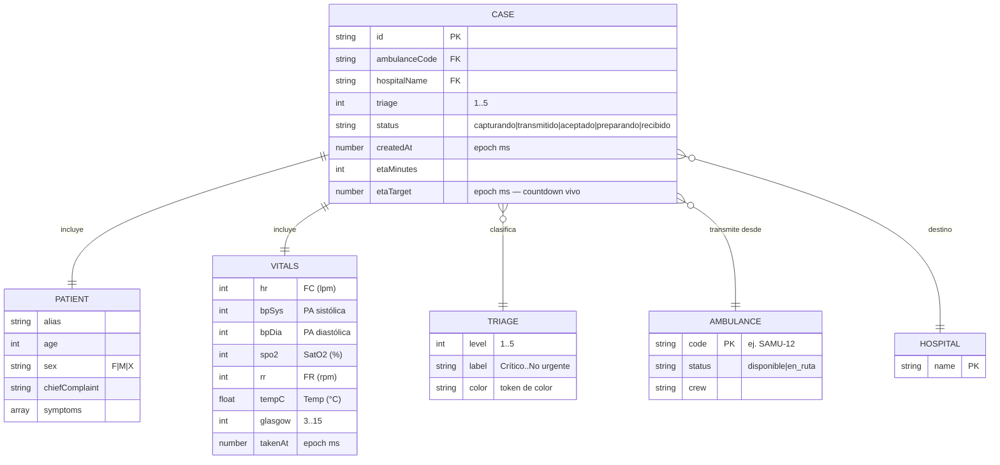

## Estructura

```
ambusync/
├── frontend/                 # Vite + React + Tailwind (el MVP)
│   ├── src/
│   │   ├── components/        # PhoneFrame, VitalsStrip, TriageBadge, EtaCountdown, ui/
│   │   ├── screens/           # RoleSelect, ambulance/, er/
│   │   ├── store/             # useCases (Zustand) + sync.ts (BroadcastChannel/localStorage)
│   │   ├── data/              # triage, vitals, status, seed
│   │   └── types.ts           # modelo de datos (CaseRecord)
│   ├── scripts/               # shots.mjs (capturas), check-mermaid.mjs (valida diagramas)
│   └── tailwind.config.js     # design tokens
├── docs/screenshots/         # muestras del funcionamiento (este README)
├── CLAUDE.md                 # contexto persistente
└── README.md
```

## Calidad

Responsive desde 360 px, foco de teclado visible, `prefers-reduced-motion` respetado,
contraste AA y copy en voz activa. El color **codifica gravedad** (triage), no decora; el
acento cian representa la señal/sincronización en vivo.

## Estado del MVP

| Fase | Descripción | Estado |
|---|---|---|
| 0 | Scaffold + design tokens | ✅ |
| 1 | PhoneFrame + navegación + selector de rol | ✅ |
| 2 | Flujo del paramédico (wizard + transmisión) | ✅ |
| 3 | Tablero de Urgencias + tiempo real simulado | ✅ |
| 4–5 | Backend Django + WebSockets reales | Trabajo futuro |
| 6 | Pulido, modo demo y documentación | ✅ |

> Proyecto académico.
